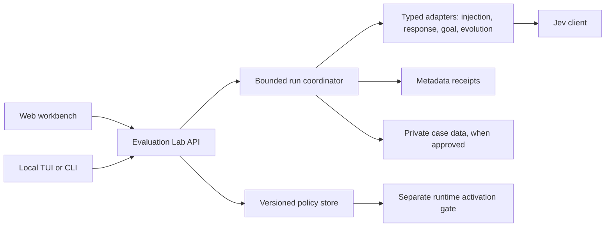

# PiBot Evaluation Lab

Status: architecture and interaction design. Beads: `pibot-7a3`.

## Product stance

The primary surface should be an authenticated web workbench inside PiBot's existing dashboard. Candidate replies, source context, policy changes, and run evidence need side-by-side comparison that a TUI makes cumbersome. A small local TUI or CLI should use the same backend for quick suite runs, status, and policy diffs. It should not become a second policy store or a second evaluator implementation.

“Customizable” means every supported decision has a typed, versioned control and a visible effect. An unrestricted text box for a live safety policy would make the system hard to audit. Advanced users can edit rubrics and adapters in code or a validated manifest, then preview the effect on a replay set before activation.

## Existing PiBot fit

PiBot already has an authenticated Hono dashboard, agent manifest settings, cascade health/actions, a review page, and a lab inbox. It has separate Jev pilots for goal judging, evolution shadow scoring, injection assessment, and tool-free response selection. The model cascade is error failover, not quality selection. The Evaluation Lab is the common experiment and control plane over these existing mechanisms; it does not replace their runtime authority or move private transcripts into a new public store.

## Workbench

The landing page answers four questions before exposing controls: **What is active? What was assessed? What changed? What needs review?** Its first row shows the selected agent and response channel, current mode (`off`, `synthetic`, `shadow`, or `enforce` where applicable), data scope, provider, budget, last run, and whether the runtime has loaded the current policy revision. Unknown status must look unknown, not healthy.

The core layout has three contextual areas:

1. **Cases and runs.** Filter by suite, source, agent, channel, label, failure class, rubric revision, and date. Show coverage and missing classes so a high aggregate score cannot hide an empty voice or indirect-injection slice.
2. **Case workspace.** Show the source/trust capsule, user task, permitted context, candidate A/B answers, rubric questions, scores with uncertainty, evaluator failures, model/cost/latency metadata, expected label, and the actual runtime decision. Raw private content appears only when the viewer has access and the case's retention scope permits it. Distinguish measured evidence from proposed policy.
3. **Policy inspector.** Controls relevant to the selected case: source-specific mode, byte limits, thresholds, models, ordering, max candidates, deadlines, daily spend/call caps, fallback on evaluator failure, provider and data scope. Every edit shows the inherited value, override source, affected cases, and a before/after replay preview. Save a draft revision, then activate through an explicit separate action with a receipt and rollback target.

There is a dedicated review queue for uncertain and contradictory cases. The owner can label `correct`, `wrong`, `unsafe`, or `needs context`, record a short reason, and compare the label against later rubric versions. These labels never automatically teach the live system; a replay and activation step is required. For mobile, stack the same three areas in case → evidence → policy order with a persistent current-case header. Keyboard navigation and accessible focus states are required on desktop.

## Core contracts

An **adapter** declares its case schema, allowed data classes, typed Jev questions, rubric version, possible outcomes, and whether it is advisory or can route a turn. Initial adapters: prompt injection, response selection, goal completion, and evolution comparison. The adapter cannot mutate a bot, ban a user, promote a skill, or execute a tool. It returns evidence to a deterministic policy function.

A **scenario** has a stable ID, suite/version, adapter ID, source and trust level, synthetic or approved-live data class, expected label or human annotation, input snapshot reference, and content hash. Private snapshots live outside Git in an owner-only store with retention limits. The public manifest contains only case metadata and synthetic fixtures.

A **policy revision** records agent, adapter, channel/response type, inheritance chain, rubric version, thresholds, size limits, model list, timeout, concurrency and daily budgets, provider allowlist, data scope, failure fallback, author, revision hash, and activation state. Resolve effective policy once per run and include its hash in the receipt. Reject invalid combinations before a run, such as live external evaluation under `synthetic` scope or best-of-N without a comparison rubric.

A **run receipt** is append-only metadata: run/case IDs, timestamp, policy and rubric hashes, model IDs, input/output hashes and byte sizes, typed scores/outcomes, selected route, error class, latency, token/cost estimate when available, and whether a human reviewed it. Preserve an explicit `unassessable` state. The receipt must not include API keys, raw prompts, answer text, or transcript excerpts. A case's private content can be fetched separately under dashboard authentication and audited access.

## Harness and TUI

One runner handles `dry-run` validation, synthetic replay, approved private replay, and metadata-only live shadow. It caps cases, concurrent calls, per-case time, total time, and spend before starting. A cancelled run records which cases completed; it does not silently fill in missing scores. The run summary reports label agreement by scenario type, severe misses, false blocks, evaluator failures, median/p95 latency, calls, and estimated spend. Small synthetic demos are labelled smoke tests, never accuracy claims.

The TUI uses the same API or in-process runner and supports `suites`, `run --synthetic`, `runs`, `inspect <case>`, and `policy diff`. It may open the web workbench at a selected case for side-by-side review. The first version is read-only for live policy activation and account moderation, because those actions need more visible context and confirmation than a terminal command provides.

## Authority and rollout

The Jev API key only enables a provider call. Per-agent provider permission and data scope separately authorize content sharing; `synthetic` remains the default. Draft and shadow policy changes do not alter live routing. Live activation requires a verified revision, replay evidence, and owner action. Runtime adapters continue to enforce tool permissions, identity, and action-specific checks outside the evaluator. Prompt-injection scores alone never ban a Telegram user.

Build order: define contracts and run receipts; register the existing synthetic Jev scripts as suites; add a read-only dashboard view; add policy drafts and replay preview; then add a local TUI. Connect live shadow sources only after explicit data-scope approval. Activate any blocking/quality-routing policy only after human-labelled calibration and a dedicated deployment check.

## Success checks

- A synthetic case can be run from the harness and inspected in the browser and TUI with the same case ID and receipt.
- Changing a threshold shows exactly which replay decisions would change, with false-positive/negative labels visible.
- Missing provider permission, over-budget, oversize input, evaluator timeout, and absent source evidence display as distinct states.
- Cancelling or failing a run leaves an accurate partial receipt and never changes the active policy.
- A live policy revision can be traced to its approver, replay result, activation time, and rollback revision.
